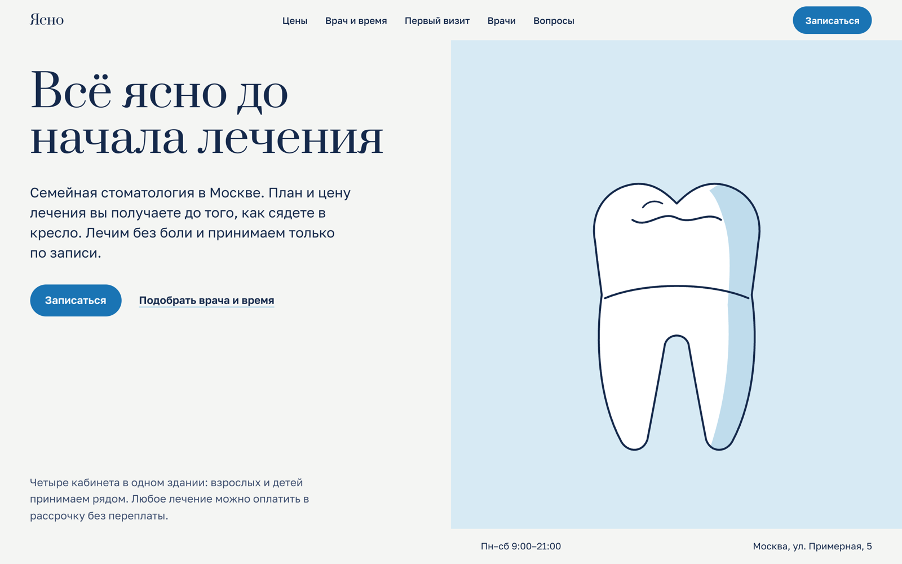

# Название сайта

Одностраничный сайт для <ниша>. Демо для портфолио: бизнес вымышленный, цены и имена — примеры.

**Демо:** https://malishq.github.io/<repo>/

## Что умеет

- …

## Стек

Next.js 16 (статическая сборка), React 19, Tailwind CSS 4, GSAP (ScrollTrigger, SplitText), Lenis. Шрифты — Google Fonts с кириллицей.

## Скриншоты



## Запуск

```bash
npm ci
npm run dev
```

Сборка: `npm run build` (папка `out/`). Выкладка на GitHub Pages: `scripts/deploy.sh`.

## Форма заявки

Форма работает без сервера: по умолчанию показывает успешную отправку. Чтобы заявки приходили на почту или в Telegram, укажите адрес приёма в переменной `NEXT_PUBLIC_FORM_ENDPOINT` (POST JSON с полями name, phone, service, comment).

## Как адаптировать под клиента

Тексты, цены и контакты — в `src/lib/site.ts` и `src/app/page.tsx`, цвета и шрифты — в `src/app/globals.css` и `src/app/layout.tsx`.
