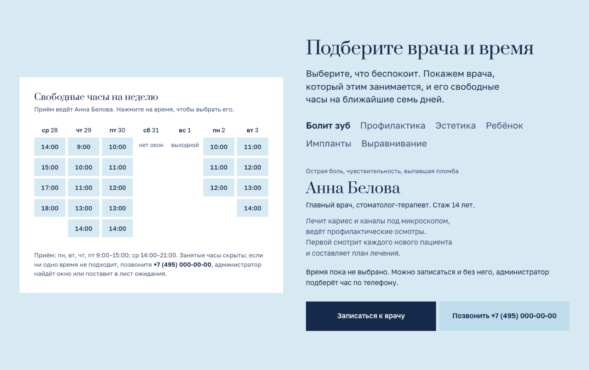
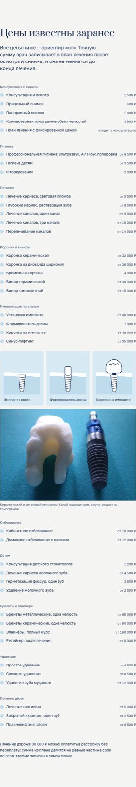
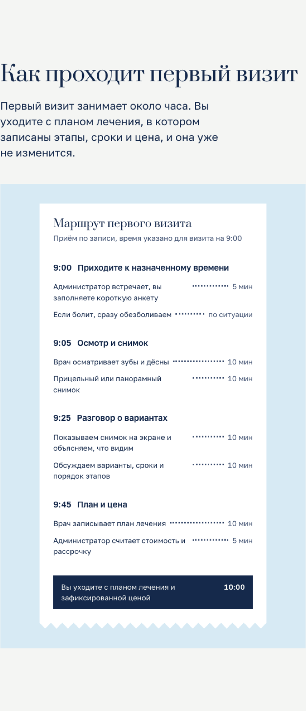
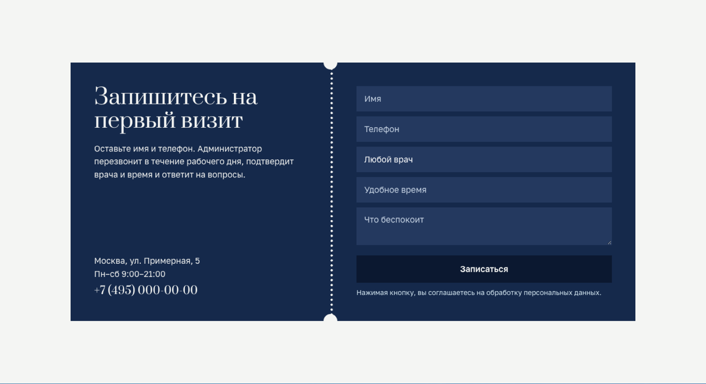
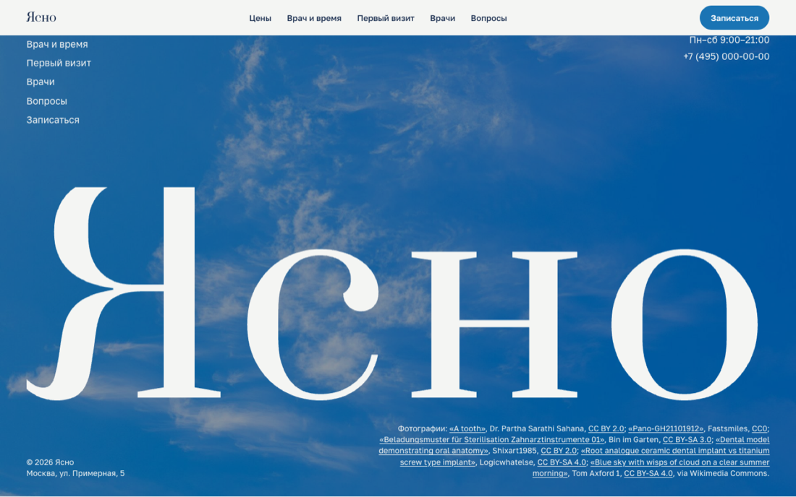

# Ясно — сайт семейной стоматологии

Одностраничный сайт стоматологической клиники: полный прайс, подбор врача и свободного времени, маршрут первого визита, врачи, ответы на вопросы и форма записи. Демо для портфолио: компания вымышленная, цены и имена — примеры.

**Демо:** https://malishq.github.io/dental-clinic-website/

## Что умеет

- Главный экран с подписной анимацией: заголовок собирается построчно (GSAP SplitText), контур зуба дорисовывается при загрузке (DrawSVGPlugin), фотографии на закреплённой сцене медленно плывут при скролле.
- Закреплённая сцена справа меняет картинку по мере чтения: рисунок зуба, зеркало и зонд, панорамный снимок, план лечения, лоток инструментов, гипсовая модель. На телефоне сцена становится полосой над первым разделом.
- Полный прайс: 10 групп и 38 позиций с ценами «от», схема имплантации по этапам, условия рассрочки.
- «Подбор врача и времени»: выбираете, что беспокоит, сайт показывает профильного врача и его свободные часы на ближайшие семь дней. Слоты считаются на клиенте из недельной сетки приёма каждого врача, занятые часы скрываются детерминированно, выбранные врач и время подставляются в форму записи. Работает с клавиатуры и на телефоне (переключатель дней), без скрипта показывает дни и часы приёма.
- Маршрут первого визита на бумажном талоне с временем каждого шага, меню методов обезболивания, плашки врачей с монограммами, ответы на 11 частых вопросов.
- Форма записи в виде талона с отрывной линией: имя, телефон, врач, удобное время, комментарий; проверка полей, экран успеха, работает без сервера.
- Плавный скролл (Lenis), появление частей каждого раздела при прокрутке, отклик кнопок и ячеек, `prefers-reduced-motion` учитывается.

## Стек

Next.js 16 (статическая сборка, `output: "export"`), React 19, Tailwind CSS 4, GSAP 3.15 (ScrollTrigger, SplitText, DrawSVGPlugin), Lenis. Шрифты Prata и Golos Text через `next/font/google` с кириллицей. Рисунки (зуб, этапы имплантации, план лечения, монограммы) сделаны в SVG кодом.

## Скриншоты












Мобильная версия: `docs/screens/mobile-hero.png`, `mobile-picker.png`, `mobile-prices.png`, `mobile-visit.png`, `mobile-contact.png`. Вся страница целиком: `desktop-full.png`, `tablet-full.png`, `mobile-full.png`.

## Запуск

```bash
npm ci
npm run dev
```

Сборка: `npm run build` (папка `out/`). Проверка кода: `npm run lint`. Выкладка на GitHub Pages: `scripts/deploy.sh` (собирает с `NEXT_PUBLIC_BASE_PATH=/dental-clinic-website` и пушит ветку `gh-pages`). Скриншоты: `python scripts/shots.py http://localhost:3000/ docs/screens` (нужен Playwright и Google Chrome).

## Форма заявки

Форма работает без сервера: по умолчанию показывает экран успешной отправки. Чтобы заявки приходили на почту или в Telegram, укажите адрес приёма в переменной `NEXT_PUBLIC_FORM_ENDPOINT` (POST JSON с полями `name`, `phone`, `doctor`, `time`, `comment`).

## Как адаптировать под клиента

- Название, телефон, адрес, часы, пункты меню: `src/lib/site.ts`.
- Прайс, врачи и их сетка приёма (дни недели и часы), проблемы для подбора, маршрут визита, методы обезболивания, вопросы и ответы, подписи к фото: `src/lib/data.ts`. Все цены и имена примерные.
- Генерация свободных часов: `src/lib/slots.ts` (шаг приёма, доля занятых слотов, выходные). Чтобы брать реальное расписание, замените `weekFor` на запрос к своей системе записи.
- Цвета, размеры шрифтов, поля страницы: переменные в начале `src/app/globals.css`. Шрифты: `src/app/layout.tsx`.
- Порядок разделов и картинки на сцене: `src/app/page.tsx`. Тексты разделов лежат в соответствующих компонентах в `src/components/`.
- Фотографии: `public/images/`, подписи и ссылки на источники в `CREDITS` в `src/lib/data.ts`; они же выводятся в подвале.

## Источники изображений

Все фотографии взяты с Wikimedia Commons под лицензиями, допускающими коммерческое использование, и лежат в `public/images/`:

| Файл | Название, автор | Лицензия |
| --- | --- | --- |
| `mirror-tooth.jpg` | [A tooth](https://commons.wikimedia.org/w/index.php?curid=74844342), Dr. Partha Sarathi Sahana | [CC BY 2.0](https://creativecommons.org/licenses/by/2.0/) |
| `xray.jpg` | [Pano-GH21101912](https://commons.wikimedia.org/wiki/File:Pano-GH21101912.jpg), Fastsmiles (закрашен маркер «R» в углу) | [CC0](https://creativecommons.org/publicdomain/zero/1.0/) |
| `instruments.jpg` | [Beladungsmuster für Sterilisation Zahnarztinstrumente 01](https://commons.wikimedia.org/wiki/File:Beladungsmuster_f%C3%BCr_Sterilisation_Zahnarztinstrumente_01.JPG), Bin im Garten | [CC BY-SA 3.0](https://creativecommons.org/licenses/by-sa/3.0/) |
| `model.jpg` | [Dental model demonstrating oral anatomy](https://commons.wikimedia.org/wiki/File:Dental_model_demonstrating_oral_anatomy_with_detailed_teeth_and_gum_structure_in_clear_display.jpg), Shixart1985 | [CC BY 2.0](https://creativecommons.org/licenses/by/2.0/) |
| `implants.jpg` | [Root analogue ceramic dental implant vs titanium screw type implant](https://commons.wikimedia.org/wiki/File:Root_analogue_ceramic_dental_implant_vs_titanium_screw_type_implant.jpg), Logicwhatelse | [CC BY-SA 4.0](https://creativecommons.org/licenses/by-sa/4.0/) |
| `sky.jpg` | [Blue sky with wisps of cloud on a clear summer morning](https://commons.wikimedia.org/wiki/File:Blue_sky_with_wisps_of_cloud_on_a_clear_summer_morning.jpg), Tom Axford 1 | [CC BY-SA 4.0](https://creativecommons.org/licenses/by-sa/4.0/) |

Фотографии уменьшены до 1800 px по ширине. Рисунки зуба, этапов имплантации, плана лечения и монограммы врачей нарисованы кодом (SVG) и не требуют указания источника.
